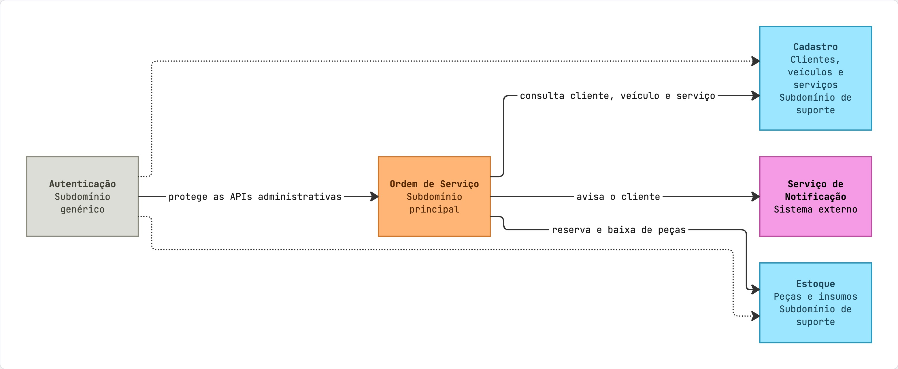

# Documento de Arquitetura — Sistema de Gestão de Oficina Mecânica

**Curso:** SOAT — Software Architecture · **Fase:** 1 (Tech Challenge FIAP)
**Status:** Proposta para aprovação · **Data:** 2026-10-10
**Stack definida:** Kotlin + Spring Boot · PostgreSQL
**Abordagem de trabalho:** Spec-Driven Development (SDD)

> Este é o **documento de arquitetura** da solução. Ele registra as decisões (no estilo ADR),
> os *bounded contexts*, a estrutura de pastas proposta e como o projeto será conduzido via SDD.
> **Nenhum código foi gerado ainda** — a implementação só começa após a aprovação deste documento
> e da quebra em tarefas (`tasks.md`).

---

## 1. Contexto e objetivo

Uma oficina mecânica de médio porte controla hoje atendimento, diagnóstico, orçamento, execução e
entrega de veículos com **anotações manuais e planilhas**, o que gera erros de priorização, falhas no
controle de peças, dificuldade de acompanhar status e perda de histórico.

O objetivo é construir o **MVP do back-end** de um Sistema Integrado de Atendimento e Execução de
Serviços, aplicando **DDD** e boas práticas de qualidade e segurança. Escopo funcional (resumo):

- Ciclo de vida da **Ordem de Serviço (OS)**: `Recebida → Em diagnóstico → Aguardando aprovação → Em execução → Finalizada → Entregue/Encerrada`.
- **Orçamento**: geração automática, aprovação, rejeição, revisão e expiração.
- **Estoque**: reserva e baixa de peças/insumos.
- **CRUDs administrativos**: clientes, veículos, serviços, peças/insumos.
- **Consulta pública** do status da OS pelo cliente.
- Monitoramento do **tempo médio de execução** (UC13 — consulta administrativa, calculada entre os
  eventos "Execução iniciada" e "Execução finalizada").

Os casos de uso estão descritos em BDD (`docs/bdd/uc01..uc13`): os **12** derivados
do Event Storming (`docs/ddd/fluxograma-oficina.mmd`) mais o **UC13** (tempo médio de execução), que
atende diretamente a um requisito do enunciado e não gera evento de domínio. Este documento é a ponte
entre essa descrição de domínio e a
implementação técnica.

### Requisitos obrigatórios do enunciado (restrições de arquitetura)

| # | Requisito | Como é atendido (resumo) |
|---|-----------|--------------------------|
| R1 | Back-end **monolítico em camadas** | Monolito modular com camadas hexagonais (§4) |
| R2 | **DDD** | Bounded contexts, agregados, VOs, eventos de domínio (§5) |
| R3 | Banco **livre, justificado** | PostgreSQL (§6) |
| R4 | **APIs RESTful** + Swagger/OpenAPI | springdoc-openapi (§8) |
| R5 | **JWT** p/ APIs administrativas | Spring Security no contexto `identity` (§8) |
| R6 | Validação **CPF/CNPJ e placa** | Value Objects no `shared-kernel` (§5) |
| R7 | Testes unitários + integração, **≥80%** | JUnit5/MockK/Testcontainers/Cucumber + Jacoco gate (§8) |
| R8 | **Docker** + docker-compose | Dockerfile multi-stage + compose (app+Postgres) (§7) |
| R9 | Tratamento de **transações** | Transação local por contexto; eventos entre contextos (§9) |

---

## 2. Abordagem de trabalho: Spec-Driven Development (SDD)

O projeto é conduzido com a **especificação como fonte da verdade** e o código derivado dela. Cada
feature tem sua pasta em `specs/<feature-slug>/`, com os artefatos produzidos pelas skills SDD
(`/spec-specify` → `/spec-plan` → `/spec-tasks`):

```
spec.md        →   plan.md          →   tasks.md        →   implementação
(o QUÊ:            (o COMO: arquitetura   (passos ordenados    (código guiado
 requisitos)         e estrutura)           e paralelizáveis)     pelos testes)
```

| Artefato | Papel | Responde |
|----------|-------|----------|
| `specs/<feature-slug>/spec.md` | Especificação funcional (user stories, requisitos, critérios de aceite) | O **quê** |
| `specs/<feature-slug>/plan.md` | Plano técnico (mapeia requisitos → hexagonal, portas, migrations) | O **como** |
| `specs/<feature-slug>/tasks.md` | Checklist ordenado e paralelizável | Em que ordem |
| `docs/adr/NNNN-*.md` | Registro versionado de cada decisão de arquitetura | Histórico das decisões |
| `docs/bdd/*.feature` | Cenários BDD (Gherkin) por caso de uso — aceite executável | Comportamento esperado |

> As skills SDD vivem em `.claude/skills/` e escrevem sempre em `specs/<feature-slug>/`. Os `.feature`
> são pré-existentes e ficam em `docs/bdd/`, executados pelo Cucumber (suíte no `bootstrap` apontando para essa pasta; só os cenários com a tag `@implementado` rodam).

**Este documento (`docs/arquitetura.md`)** orienta os `plan.md` de cada feature e os ADRs.

---

## 3. Visão geral da arquitetura

A tensão central do projeto: o enunciado pede **"monolito em camadas"**, mas a solução deve ser
**profissional e pronta para evoluir para microsserviços**. A resposta é um:

> **Monolito Modular com Arquitetura Hexagonal (Ports & Adapters), organizado por Bounded Contexts.**

Isso satisfaz o requisito (é um único deployable, em camadas) **e** deixa cada contexto extraível
como serviço independente no futuro, sem reescrever o domínio.

```
                          ┌───────────────────────── Monolito (1 deployable) ─────────────────────────┐
   HTTP/REST  ─────────►  │  Adapters IN (web)                                                         │
   (Swagger)              │        │                                                                   │
                          │        ▼                                                                   │
                          │   Application (use cases / portas de entrada)                              │
                          │        │                                                                   │
                          │        ▼                                                                   │
                          │     Domain (agregados, VOs, eventos, regras)  ◄── núcleo puro, sem framework│
                          │        │                                                                   │
                          │        ▼ (portas de saída)                                                 │
                          │   Adapters OUT (persistence JPA, ACL entre módulos, event publisher)       │
                          │        │                                                                   │
                          └────────┼───────────────────────────────────────────────────────────────┘
                                   ▼
                          PostgreSQL (schema por módulo)
```

**Regra de dependência (hexagonal):** o fluxo de dependência aponta sempre para dentro.
`domain` não conhece `application`; `application` não conhece `adapter`; nada do núcleo conhece Spring.
Frameworks ficam nas bordas (adapters). Isso é o que torna o domínio testável e portável.

**Mapa "camadas (PDF)" ↔ "hexagonal":**

| Camada clássica (enunciado) | Equivalente hexagonal |
|-----------------------------|------------------------|
| Controllers | Adapter IN (web) |
| Use Cases | Application (portas de entrada) |
| Domain / Domain Services | Domain |
| Repositories | Portas de saída + Adapter OUT (persistence) |
| Banco de Dados | PostgreSQL |

---

## 4. Decisões arquiteturais (resumo estilo ADR)

Cada decisão terá um ADR detalhado em `docs/adr/`. Resumo:

### ADR-0002 — Monolito Modular + Hexagonal (decisão principal)
**Decisão:** um único deployable dividido em módulos por *bounded context*, cada um com camadas
hexagonais internas.
**Alternativas:** (a) monolito em camadas tradicional — simples, mas vira "big ball of mud" e dificulta
split futuro; (b) microsserviços desde já — proibido pelo enunciado e excessivo para um MVP.
**Consequências:** +isolamento de domínio, +testabilidade, +rota clara p/ microsserviços; −um pouco
mais de cerimônia (portas/adapters) que um CRUD em camadas.

### ADR-0003 — Kotlin + Spring Boot, build Gradle multi-módulo
Kotlin (null-safety, data classes, código conciso para VOs e agregados) sobre o ecossistema Spring
(Web, Data JPA, Security, springdoc). **Gradle multi-módulo** (um módulo Gradle por contexto) para
impor as fronteiras em tempo de compilação. Catálogo de versões em `gradle/libs.versions.toml`.

### ADR-0004 — PostgreSQL com schema-per-module
Relacional **ACID** (essencial para reserva→baixa de peças e transições de status), constraints de
unicidade (placa, CPF/CNPJ), e **um schema por módulo** para isolar contextos — facilitando a
extração de cada um para seu próprio banco. Migrações versionadas com **Flyway**.

### ADR-0005 — Bounded Contexts e fronteiras de módulo
Contextos definidos em §5. Regra: um módulo só depende do `shared-kernel` e das **portas públicas**
de outro módulo, nunca das suas classes internas.

### ADR-0006 — Comunicação entre módulos por portas e eventos
Chamadas síncronas entre contextos passam por uma **porta de saída (ACL)**; hoje implementada
in-process chamando a porta de entrada do outro módulo, amanhã trocável por cliente HTTP/mensageria
**sem tocar no domínio**. Eventos de domínio publicados via abstração (`ApplicationEventPublisher`
in-process) → migrável para Kafka/RabbitMQ.

### ADR-0007 — Autenticação JWT (subdomínio genérico)
Spring Security + JWT no contexto `autenticacao` (subdomínio **genérico** — sem regra de negócio
própria). Rotas administrativas (CRUDs, operações da OS) exigem token; a **consulta de status pelo
cliente (UC12)** é pública/leve.

### ADR-0008 — Estratégia de testes e cobertura
JUnit5 + MockK + AssertJ (unit), Testcontainers/Postgres (integração), **Cucumber-JVM** reaproveitando
os `.feature` de `docs/bdd/`. **Jacoco** com gate de **80%** sobre `domain` + `application`.

### ADR-0009 — Transações e consistência
Consistência **forte dentro do contexto** (uma transação por caso de uso); **eventual entre contextos**
via eventos. Ver §9.

### ADR-0010 — Serviço de Notificação por e-mail (SMTP)
**Decisão:** o canal de notificação ao cliente (orçamento gerado/expirado, veículo pronto — UC03, UC08,
UC10) é **e-mail via SMTP**. Em **dev**, um container **Mailpit** no docker-compose captura os e-mails
(sem credenciais reais, visualização por UI web); em **prod**, aponta-se para um SMTP real (ex.: AWS SES).
A integração fica no adapter `ordemservico/adapter/outbound/notificacao/`, atrás de `NotificacaoPort`.
**Padrão outbox:** a notificação é gravada numa tabela *outbox* e enviada de forma assíncrona, garantindo
que uma falha de SMTP não derrube a transação de negócio (ex.: aprovar orçamento).
**Alternativas:** SMS/WhatsApp (Twilio/SNS) — exigem credenciais de provedor, fricção alta p/ MVP;
broker de mensageria — adia-se para a fase de microsserviços.
**Consequências:** +demo realista sem custo/credencial, +porta trocável por SES/SMS sem tocar no domínio;
−e-mail não é tempo real (o acompanhamento em tempo real é atendido pela consulta pull da UC12).

---

## 5. Mapa de contexto e Bounded Contexts (DDD)

A arquitetura segue o **mapa de contexto** oficial do domínio (`docs/ddd/mapa-de-contexto.jpg`):



### 5.1 Classificação de subdomínios

O mapa classifica os subdomínios segundo o DDD — isso orienta onde investir esforço (o **core** é onde
mora a vantagem competitiva; **suporte** e **genérico** devem ser simples ou terceirizados):

| Subdomínio | Tipo | Papel no negócio | Decisão de arquitetura |
|------------|------|------------------|------------------------|
| **Ordem de Serviço** | **Principal (core)** | O diferencial da oficina: ciclo de vida da OS + orçamento | Maior investimento de modelagem (agregados ricos, regras de transição) |
| **Cadastro** (clientes, veículos, serviços) | **Suporte** | Dados de apoio consultados pela OS | CRUD simples, modelo anêmico aceitável |
| **Estoque** (peças e insumos) | **Suporte** | Reserva e baixa de peças | CRUD + regras de reserva; integra com a OS por porta |
| **Autenticação** | **Genérico** | Protege as APIs administrativas | Solução padrão (Spring Security + JWT), sem regra de negócio própria |
| **Serviço de Notificação** | **Sistema externo** | Avisa o cliente | **E-mail via SMTP**; Mailpit em dev, SMTP/SES em prod. Fora do monolito, acessado por `NotificacaoPort` (ver ADR-0010) |

### 5.2 Relações entre contextos (do mapa)

- **Autenticação → (protege) →** APIs administrativas da OS, Cadastro e Estoque.
- **Ordem de Serviço → (consulta cliente/veículo/serviço) →** Cadastro.
- **Ordem de Serviço → (avisa o cliente) →** Serviço de Notificação *(externo)*.
- **Ordem de Serviço → (reserva e baixa de peças) →** Estoque.

Em todas as relações, a OS é o **cliente (downstream)** e os demais são **fornecedores (upstream)**;
a OS protege seu modelo com uma **camada anticorrupção (ACL)** em cada porta de saída.

### 5.3 Bounded Contexts (contextos de solução → módulos)

| Módulo | Subdomínio | Agregados / Entidades | VOs principais | UCs |
|--------|-----------|------------------------|----------------|-----|
| **ordemservico** | Principal | `OrdemServico` (raiz), `Orcamento`, `ItemOrcamento` | `StatusOS`, `StatusOrcamento` | UC01–UC13 |
| **cadastro** | Suporte | `Cliente` (raiz), `Veiculo`, `Servico` | `Documento` (CPF/CNPJ), `Placa`, `Dinheiro` | CRUD |
| **estoque** | Suporte | `Peca`, `Estoque`, `ReservaPeca` | `Quantidade` | UC04, UC09 |
| **autenticacao** | Genérico | `Usuario`, `Perfil` | `Token` | (transversal) |
| _(externo)_ **Notificação** | Sistema externo | — (fora do monolito) | — | UC03, UC08, UC10 |

**`shared-kernel`** (compartilhado, sem framework): VOs transversais (`Cpf`, `Cnpj`, `Documento`,
`Placa`, `Dinheiro`), base de eventos de domínio (`DomainEvent`, `DomainEventPublisher`) e
tratamento de erros (`DomainException`).

**Eventos de domínio** (do Event Storming): `OrdemServicoCriada`, `DiagnosticoIniciado/Realizado/Finalizado`,
`OrcamentoGerado/Aprovado/Rejeitado/Revisado/Expirado`, `PecaReservada`, `PecaIndisponivel`,
`PecasBaixadas`, `ExecucaoIniciada/Finalizada`, `VeiculoEntregue`, `OsEncerrada`.

> **Hotspots** ainda em aberto no Event Storming (a resolver na spec): prazo de validade do orçamento
> (UC08), o que fazer quando a peça não é identificada (UC02) e política de peça indisponível (UC04).

### 5.4 Por que Cadastro é um único contexto
O mapa funde clientes, veículos e serviços num só subdomínio de **suporte**. São dados de apoio,
consultados pela OS, sem regra de negócio rica — separá-los em três contextos seria over-engineering
para um MVP. Ficam juntos no módulo `cadastro` (cada um como seu próprio agregado).

### 5.5 Por que a OS e o Orçamento ficam no mesmo contexto
O ciclo de vida do orçamento (aprovar/rejeitar/revisar/expirar) muda diretamente o status da OS e exige
consistência transacional forte. Mantê-los no mesmo contexto (`ordemservico`) evita transações
distribuídas no núcleo. Cadastro e Estoque, periféricos ao fluxo, ficam em contextos separados e se
comunicam via portas/eventos.

---

## 6. Banco de dados — justificativa (PostgreSQL)

- **ACID**: reserva e baixa de peças (UC04/UC09) e transições de status exigem garantias transacionais
  fortes — MongoDB seria mais frágil nesses fluxos multi-entidade.
- **Integridade**: constraints de unicidade (`placa`, `documento`) e chaves estrangeiras.
- **Isolamento por contexto**: um **schema por módulo** (`autenticacao`, `cadastro`, `estoque`,
  `ordemservico`) — cada contexto é dono do seu schema; ninguém faz `JOIN` cruzando fronteiras.
  Quando um contexto virar microsserviço, o schema vira banco próprio.
- **Maturidade/custo**: open-source, excelente suporte no ecossistema Spring (Data JPA + Flyway).

---

## 7. Estrutura de pastas proposta (scaffold)

Package root: `com.fiap.soat.oficina`. Build Gradle multi-módulo; `bootstrap` é o único deployable
(Spring Boot app) que monta todos os módulos.

```
.
├── settings.gradle.kts              # inclui todos os módulos
├── build.gradle.kts                 # config comum (kotlin, jacoco, detekt, spring)
├── gradle/libs.versions.toml        # catálogo de versões
├── gradlew / gradlew.bat
├── .env.example
├── docker/
│   ├── Dockerfile                   # build multi-stage da app (bootstrap)
│   └── docker-compose.yml           # app + postgres:16 + mailpit (SMTP de dev)
│
├── specs/
│   └── <feature-slug>/              # SDD por feature: spec.md · plan.md · tasks.md
├── docs/
│   ├── arquitetura.md               # ESTE documento
│   ├── adr/                         # ADRs
│   ├── bdd/                         # cenários BDD (.feature) por caso de uso
│   └── ddd/                         # event-storming.pdf, diagramas.pdf, linguagem-ubiqua.md
│
├── bootstrap/                       # aplicação Spring Boot (main)
│   └── src/main/
│       ├── kotlin/com/fiap/soat/oficina/OficinaApplication.kt
│       └── resources/application.yml, db/migration/ (Flyway)
│
├── shared-kernel/                   # VOs + base de eventos/erros (sem framework)
│   └── src/main/kotlin/.../shared/{domain/vo, domain/event, domain/error}
│
└── modules/
    ├── autenticacao/                 # genérico (JWT)
    ├── cadastro/                     # suporte (clientes, veículos, serviços)
    ├── estoque/                      # suporte (peças e insumos)
    └── ordemservico/                 # principal / core (OS + orçamento)
```

**Anatomia de cada módulo** (ex.: `ordemservico`, mesmo formato nos demais):

```
modules/ordemservico/
├── build.gradle.kts                 # depende de shared-kernel + portas de outros módulos
└── src/main/kotlin/com/fiap/soat/oficina/ordemservico/
    ├── domain/
    │   ├── model/       # OrdemServico (raiz), Orcamento, ItemOrcamento, StatusOS
    │   ├── event/       # OrdemServicoCriada, OrcamentoAprovado, ...
    │   ├── service/     # TransicaoStatusService (regras de transição)
    │   └── port/        # ('inbound'/'outbound' — evita as palavras reservadas 'in'/'out' do Kotlin)
    │       ├── inbound/   # *UseCase (entrada): CriarOs, GerarOrcamento, AprovarOrcamento, ...
    │       └── outbound/  # OrdemServicoRepository, EstoquePort (ACL), CadastroPort (ACL), NotificacaoPort (externo)
    ├── application/usecase/   # implementações dos use cases
    └── adapter/
        ├── inbound/web/   # controllers REST, DTOs, mappers, @ControllerAdvice
        └── outbound/
            ├── persistence/  # @Entity JPA, Spring Data repo, RepositoryAdapter, mappers
            ├── acl/          # implementa EstoquePort/CadastroPort chamando a porta do outro módulo
            └── notificacao/  # implementa NotificacaoPort → integra com o sistema externo de notificação
└── src/test/kotlin/...  # domain (unit), application (MockK), integration (Testcontainers), bdd (Cucumber)
```

---

## 8. Transversais

**APIs REST + OpenAPI** — springdoc-openapi gera o Swagger a partir dos controllers; contratos também
versionados em `specs/.../contracts/openapi.yaml`. Convenção de rotas: `/api/v1/admin/**` (protegidas,
versionadas no caminho) e `/api/os/{id}/status` (consulta pública do cliente — UC12).

**Segurança (JWT)** — filtro do Spring Security valida o token nas rotas administrativas; `autenticacao`
emite/valida. Validação de dados sensíveis (CPF/CNPJ, placa) acontece nos **VOs** do `shared-kernel`,
falhando cedo no domínio — não só no controller.

**Testes e cobertura** — pirâmide: muitos testes de domínio (puros, rápidos), testes de use case com
MockK, testes de integração com Testcontainers/Postgres, e os `.feature` de `bdd/` executados via
Cucumber-JVM como testes de aceitação. Gate Jacoco de **80%** sobre `domain`+`application` no CI.

---

## 9. Transações e consistência

- **Dentro do contexto:** cada caso de uso roda em **uma transação** (`@Transactional` no adapter/app).
  Ex.: iniciar execução (UC09) baixa peças e muda status atomicamente dentro de `ordemservico`/`estoque`.
- **Entre contextos:** consistência **eventual** via eventos de domínio. Ex.: `ordemservico` pede reserva
  ao `estoque` pela porta `EstoquePort`; a resposta (`PecaReservada`/`PecaIndisponivel`) orienta o
  fluxo. Isso evita transação distribuída e já modela a futura comunicação assíncrona entre serviços.
- **Idempotência/outbox:** quando a comunicação virar assíncrona (microsserviços), o publisher de
  eventos ganha um padrão *outbox* — previsto na abstração desde já, sem custo agora.

---

## 10. Prontidão para microsserviços (rota de evolução)

O scaffold garante a migração **sem reescrever o domínio**, por quatro mecanismos:

1. **Módulos Gradle isolados** — cada contexto compila sozinho; vira um serviço trocando o `bootstrap`
   por um `main` próprio.
2. **Comunicação só por portas (ACL)** — a implementação in-process é trocada por cliente HTTP/mensageria
   sem alterar `domain`/`application`.
3. **Schema-per-module** — cada schema do Postgres migra para seu próprio banco.
4. **Eventos via publisher abstrato** — trocável por um broker (Kafka/RabbitMQ) com padrão outbox.

Ordem natural de extração: `estoque` (fluxo mais assíncrono) → `cadastro` (CRUDs) →
`ordemservico` por último (núcleo). A **Notificação** já nasce fora do monolito (sistema externo).

---

## 11. Próximos passos (após aprovação deste documento)

1. **Por feature (SDD):** `/spec-specify` → `specs/<slug>/spec.md`, `/spec-plan` → `plan.md`, `/spec-tasks` → `tasks.md` (resolvendo os *hotspots* de §5 quando aplicável).
2. **ADRs** — registrar as decisões de §4 em `docs/adr/`.
3. **Implementação** — seguir o `tasks.md`; gate `./gradlew build` (testes + cobertura ≥ 80%).

> Nada acima é implementado antes da sua aprovação deste documento.
