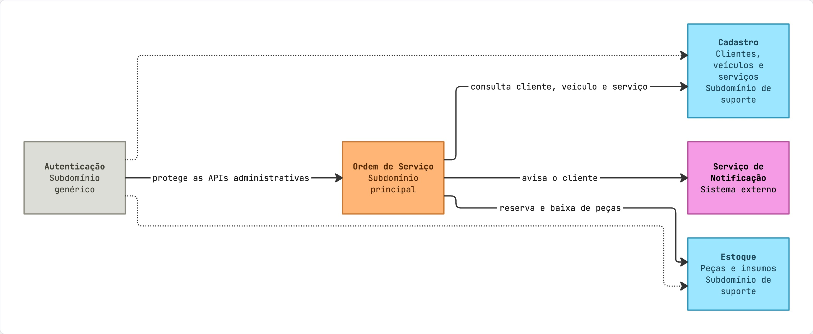
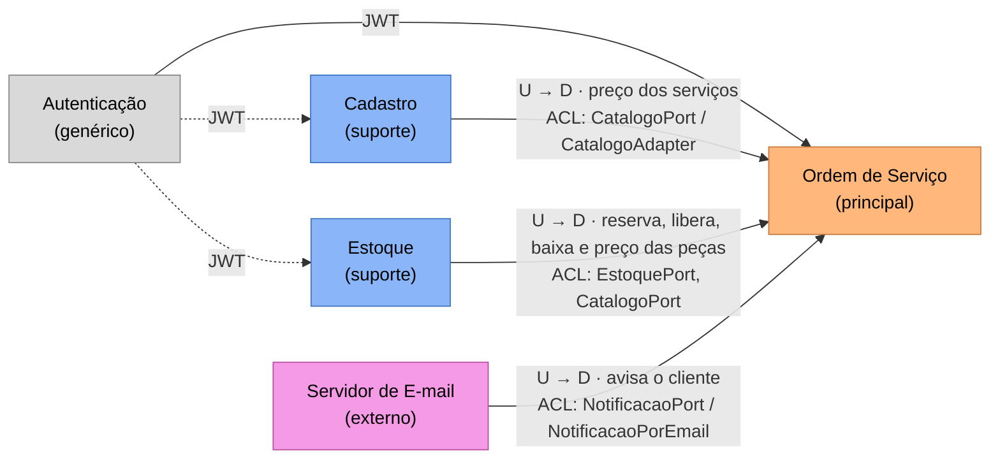
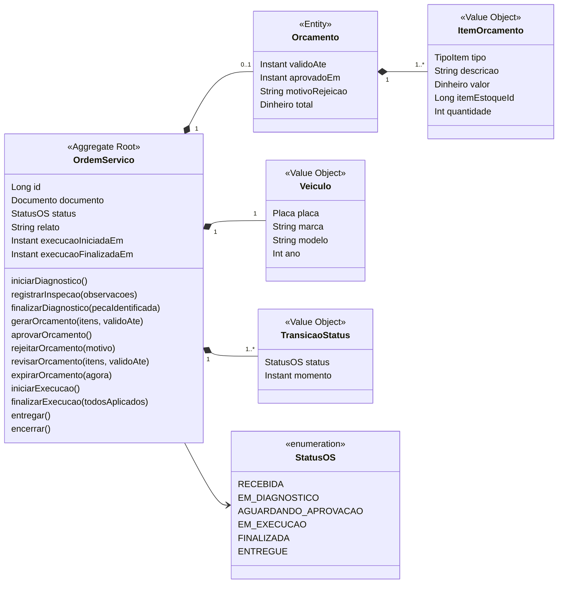
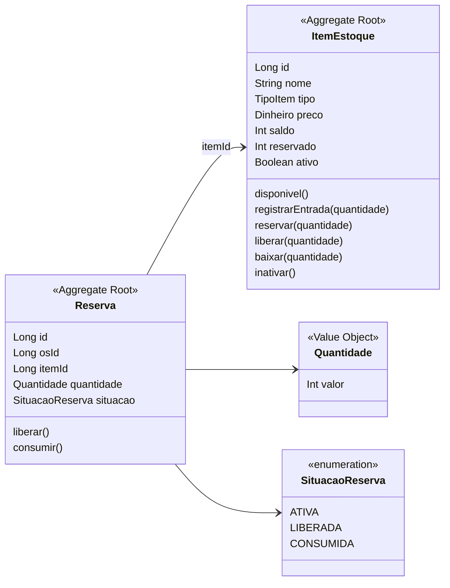
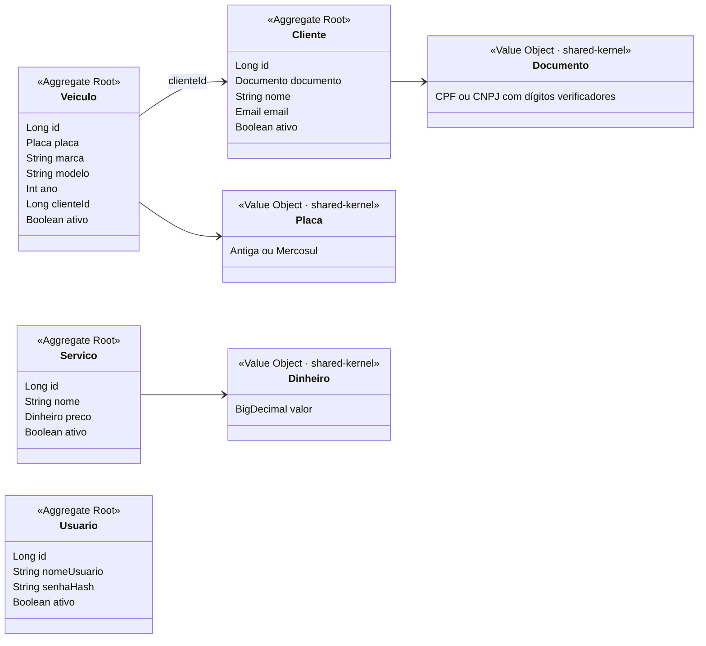
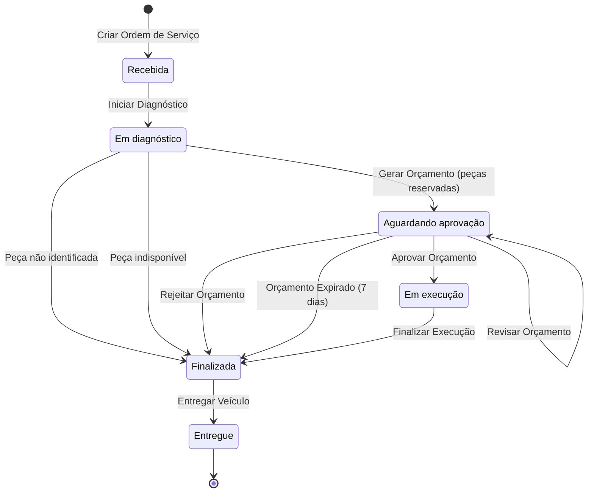
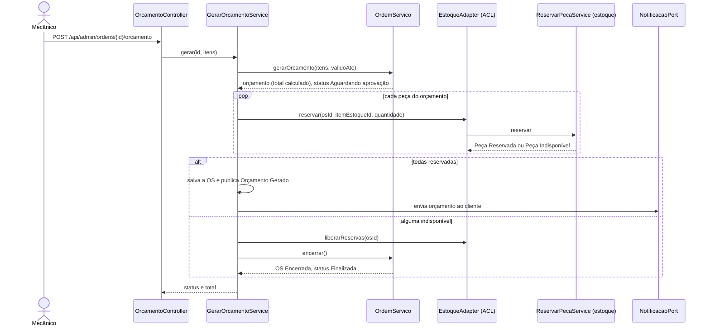

# Diagramas DDD — Oficina Mecânica

Diagramas do domínio e da solução, alinhados ao código da branch `main`. O Event Storming está em
[`event-storming.md`](event-storming.md) e a linguagem ubíqua em [`linguagem-ubiqua.md`](../linguagem-ubiqua.md).

## 1. Mapa de contexto

Mapa original do workshop:

Relações implementadas. A OS é sempre o contexto cliente (downstream) e protege seu modelo com uma camada
anticorrupção (ACL) em cada porta de saída:

Os contextos compartilham só o `shared-kernel` (`Documento`, `Placa`, `Dinheiro`, `DomainEvent`). No MVP a OS guarda documento, placa, marca, modelo e ano informados na abertura e não consulta o Cadastro nesse momento; o orçamento busca nome e preço pela `CatalogoPort` (ACL `CatalogoAdapter`).

## 2. Subdomínios e bounded contexts

| Bounded context | Módulo Gradle | Subdomínio | Schema no banco |
|-----------------|---------------|------------|-----------------|
| Ordem de Serviço | `modules/ordemservico` | Principal | `ordemservico` |
| Cadastro | `modules/cadastro` | Suporte | `cadastro` |
| Estoque | `modules/estoque` | Suporte | `estoque` |
| Autenticação | `modules/autenticacao` | Genérico | `autenticacao` |
| — | `shared-kernel` | Kernel compartilhado | — |

## 3. Agregados, entidades e objetos de valor

### Ordem de Serviço

### Estoque

### Cadastro e Autenticação

## 4. Ciclo de vida da Ordem de Serviço

Os 6 status do enunciado e as transições que o agregado `OrdemServico` aceita. Qualquer outra transição é
recusada com `409`.

## 5. Gerar Orçamento com reserva de peças

O fluxo que cruza dois bounded contexts numa só transação.

## 6. C4

Mantidos em [`docs/c4/`](../../c4/).

[C4 Nível 1 — Contexto](../../c4/c4-nivel1-contexto.mmd)

[C4 Nível 2 — Contêineres](../../c4/c4-nivel2-conteineres.mmd)

[C4 Nível 3 — Componentes](../../c4/c4-nivel3-componentes.mmd)
