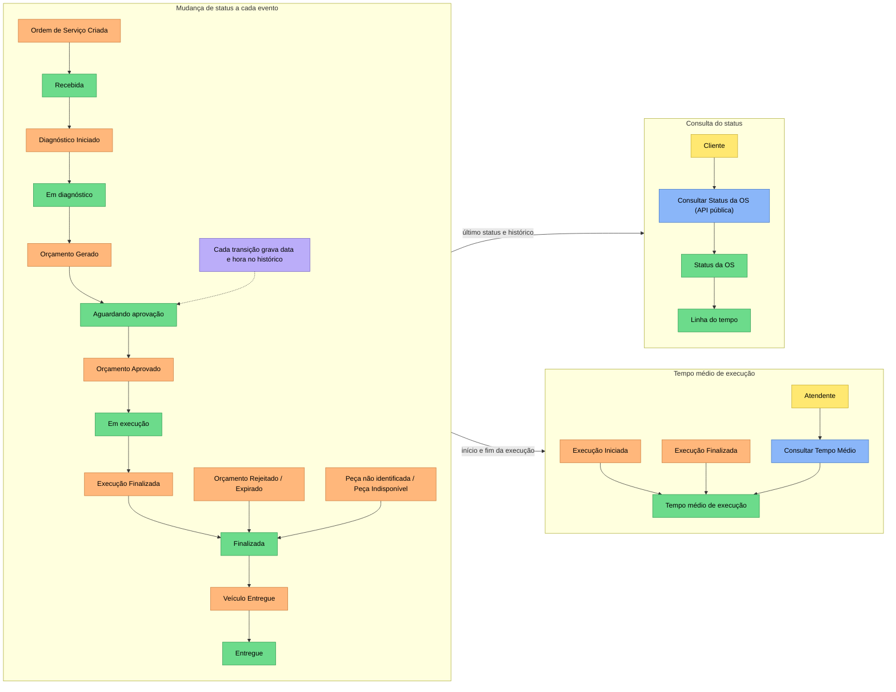
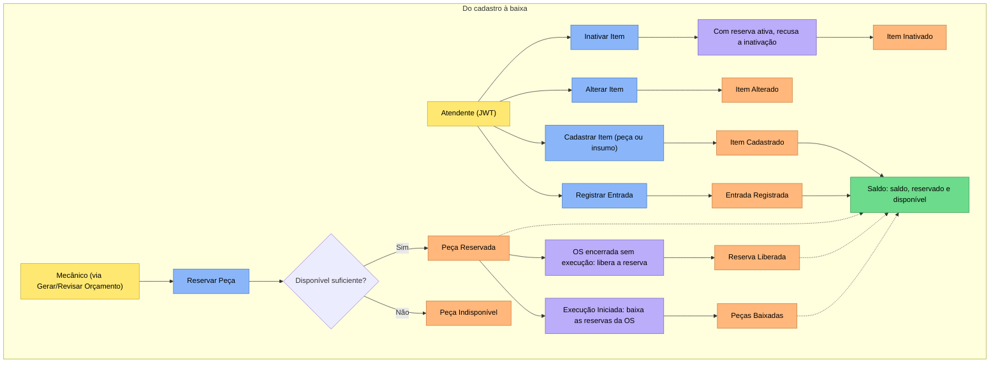

# Event Storming — Oficina Mecânica

Exportado do board **Tech01** no Miro e alinhado ao código da branch `main`. Onde o workshop e a
implementação divergiram, vale o código, e a divergência fica registrada em [Hotspots](#hotspots-e-decisões).

Os três fluxos pedidos no enunciado:

1. [Criação da Ordem de Serviço](#1-criação-da-ordem-de-serviço) — recepção, diagnóstico, orçamento, aprovação, execução e entrega
2. [Acompanhamento da Ordem de Serviço](#2-acompanhamento-da-ordem-de-serviço) — mudança de status, consulta e tempo médio
3. [Gestão de peças e insumos](#3-gestão-de-peças-e-insumos) — cadastro, entrada, reserva, liberação e baixa

## Legenda

| Cor | Elemento | Exemplo |
|-----|----------|---------|
| Laranja | Evento de domínio (passado) | Orçamento Aprovado |
| Azul | Comando (imperativo) | Aprovar Orçamento |
| Amarelo | Ator | Mecânico |
| Lilás | Política ("quando X, então Y") | Rejeitado: encerra a OS e libera reservas |
| Verde | Read model | Status da OS: Em execução |
| Rosa | Sistema externo | Servidor de E-mail |

## 1. Criação da Ordem de Serviço

### Parte 1 de 3 — Recepção e Diagnóstico

```mermaid
flowchart LR
    subgraph S1["1. Recepção"]
        direction LR
        ATD1["Atendente"] --> B["Criar Ordem de Serviço"]
        B --> C["Ordem de Serviço Criada"]
        C --> RM1["Status da OS: Recebida"]
    end

    subgraph S2["2. Diagnóstico"]
        direction LR
        MEC1["Mecânico"] --> D["Iniciar Diagnóstico"]
        D --> E["Diagnóstico Iniciado"]
        E --> RM2["Status da OS: Em diagnóstico"]
        E --> F["Registrar Inspeção"]
        F --> H["Diagnóstico Realizado"]
        H --> I["Finalizar Diagnóstico"]
        I --> G{"Peça identificada?"}
        G -- "Sim" --> J["Diagnóstico Finalizado"]
        G -- "Não" --> POLX["Sem peça identificada, encerra a OS"]
        POLX --> ENCX["OS Encerrada"]
        ENCX --> RMX["Status da OS: Finalizada"]
    end

    S1 -- "OS Criada" --> S2

    classDef evento fill:#FFB77B,stroke:#C97A3A,color:#000
    classDef comando fill:#8AB6F9,stroke:#3F74C4,color:#000
    classDef ator fill:#FFE871,stroke:#C4A92A,color:#000
    classDef politica fill:#BBADF9,stroke:#7563C4,color:#000
    classDef readmodel fill:#6CDB8B,stroke:#2E9950,color:#000
    class C,E,H,J,ENCX evento
    class B,D,F,I comando
    class ATD1,MEC1 ator
    class POLX politica
    class RM1,RM2,RMX readmodel
```

### Parte 2 de 3 — Orçamento e Aprovação

```mermaid
flowchart LR
    subgraph S3["3. Orçamento"]
        direction LR
        MEC2["Mecânico"] --> K["Gerar Orçamento"]
        K --> M["Reservar Peça"]
        M --> EXT1["Estoque"]
        EXT1 --> O{"Peça disponível?"}
        O -- "Sim" --> P["Peça Reservada"]
        P --> L["Orçamento Gerado"]
        L --> RMA["Status da OS: Aguardando aprovação"]
        L --> POLN["Envia o orçamento ao cliente"]
        POLN --> SMTP1["Servidor de E-mail"]
        O -- "Não" --> Q["Peça Indisponível"]
        Q --> POLQ["Falta peça: libera as reservas e encerra a OS"]
        POLQ --> ENCQ["OS Encerrada"]
    end

    subgraph S4["4. Aprovação"]
        direction LR
        CLI["Cliente (link do e-mail, sem login)"] --> R["Consultar Orçamento"]
        R --> S{"Decisão do cliente"}
        S -- "Aprova" --> CA["Aprovar Orçamento"]
        CA --> T["Orçamento Aprovado"]
        T --> RMX["Status da OS: Em execução"]
        S -- "Rejeita" --> CR["Rejeitar Orçamento"]
        CR --> U["Orçamento Rejeitado"]
        S -- "Pede revisão" --> V["Revisar Orçamento"]
        V --> X["Orçamento Revisado"]
        X -.-> R
        S -- "Sem resposta em 7 dias" --> POL2["Job agendado verifica a validade"]
        POL2 --> W["Orçamento Expirado"]
        U --> POL1["Rejeitado ou expirado: libera as reservas, encerra a OS e avisa o cliente"]
        W --> POL1
        POL1 --> ENC["OS Encerrada"]
        ENC --> RMF["Status da OS: Finalizada"]
    end

    S3 -- "Orçamento Gerado" --> S4

    classDef evento fill:#FFB77B,stroke:#C97A3A,color:#000
    classDef comando fill:#8AB6F9,stroke:#3F74C4,color:#000
    classDef ator fill:#FFE871,stroke:#C4A92A,color:#000
    classDef politica fill:#BBADF9,stroke:#7563C4,color:#000
    classDef readmodel fill:#6CDB8B,stroke:#2E9950,color:#000
    classDef externo fill:#F59BE6,stroke:#B8509F,color:#000
    class L,P,Q,T,U,W,X,ENC,ENCQ evento
    class K,M,CA,CR,V comando
    class MEC2,CLI ator
    class POL1,POL2,POLQ,POLN politica
    class R,RMA,RMX,RMF readmodel
    class EXT1,SMTP1 externo
```

### Parte 3 de 3 — Execução e Entrega

```mermaid
flowchart LR
    subgraph S5["5. Execução"]
        direction LR
        MEC3["Mecânico"] --> Y["Iniciar Execução"]
        Y --> Z["Execução Iniciada"]
        Z --> POL3["Dar baixa nas peças reservadas"]
        POL3 --> AB["Peças Baixadas"]
        AB --> AC["Finalizar Execução"]
        AC --> AD["Execução Finalizada"]
        AD --> RMFIN["Status da OS: Finalizada"]
        AD --> POL6["Avisa o cliente: veículo pronto"]
        POL6 --> SMTP2["Servidor de E-mail"]
    end

    subgraph S6["6. Entrega"]
        direction LR
        ATD2["Atendente"] --> AE["Entregar Veículo"]
        AE --> AF["Veículo Entregue"]
        AF --> RMENT["Status da OS: Entregue"]
        AF --> AG["Comprovante"]
    end

    S5 -- "Execução Finalizada" --> S6

    classDef evento fill:#FFB77B,stroke:#C97A3A,color:#000
    classDef comando fill:#8AB6F9,stroke:#3F74C4,color:#000
    classDef ator fill:#FFE871,stroke:#C4A92A,color:#000
    classDef politica fill:#BBADF9,stroke:#7563C4,color:#000
    classDef readmodel fill:#6CDB8B,stroke:#2E9950,color:#000
    classDef externo fill:#F59BE6,stroke:#B8509F,color:#000
    class Z,AB,AD,AF evento
    class Y,AC,AE comando
    class MEC3,ATD2 ator
    class POL3,POL6 politica
    class AG,RMFIN,RMENT readmodel
    class SMTP2 externo
```

## 2. Acompanhamento da Ordem de Serviço

Diagnóstico Realizado, Diagnóstico Finalizado, Peça Reservada, Orçamento Revisado, Execução Iniciada e
Peças Baixadas não mudam o status da OS.

## 3. Gestão de peças e insumos

Regras do estoque: a reserva é tudo ou nada (sem reserva parcial), uma OS tem no máximo uma reserva ativa por
item, a baixa consome todas as reservas ativas da OS e é idempotente, e o banco garante `saldo ≥ 0` e
`reservado ≤ saldo` com lock de linha no item.

## Elementos e onde estão no código

### Eventos de domínio

| Evento | Classe | Módulo | Muda o status para |
|--------|--------|--------|--------------------|
| Ordem de Serviço Criada | `OrdemServicoCriada` | ordemservico | Recebida |
| Diagnóstico Iniciado | `DiagnosticoIniciado` | ordemservico | Em diagnóstico |
| Diagnóstico Realizado | `DiagnosticoRealizado` | ordemservico | — |
| Diagnóstico Finalizado | `DiagnosticoFinalizado` | ordemservico | — |
| Orçamento Gerado | `OrcamentoGerado` | ordemservico | Aguardando aprovação |
| Orçamento Aprovado | `OrcamentoAprovado` | ordemservico | Em execução |
| Orçamento Rejeitado | `OrcamentoRejeitado` | ordemservico | Finalizada (via OS Encerrada) |
| Orçamento Revisado | `OrcamentoRevisado` | ordemservico | — |
| Orçamento Expirado | `OrcamentoExpirado` | ordemservico | Finalizada (via OS Encerrada) |
| Execução Iniciada | `ExecucaoIniciada` | ordemservico | — |
| Execução Finalizada | `ExecucaoFinalizada` | ordemservico | Finalizada |
| Veículo Entregue | `VeiculoEntregue` | ordemservico | Entregue |
| OS Encerrada | `OsEncerrada` | ordemservico | Finalizada |
| Peça Reservada | `PecaReservada` | estoque | — |
| Peça Indisponível | `PecaIndisponivel` | estoque | — |
| Reserva Liberada | `ReservaLiberada` | estoque e ordemservico | — |
| Peças Baixadas | `PecasBaixadas` | estoque e ordemservico | — |

Item Cadastrado, Item Alterado, Entrada Registrada e Item Inativado são fatos do workshop que o MVP trata como
CRUD, sem classe de evento.

### Comandos

| Comando | Caso de uso (código) | Endpoint | Ator |
|---------|----------------------|----------|------|
| Criar Ordem de Serviço | `CriarOrdemServicoService` (UC01) | `POST /api/admin/ordens` | Atendente |
| Iniciar / Registrar Inspeção / Finalizar Diagnóstico | `RealizarDiagnosticoService` (UC02) | `POST /api/admin/ordens/{id}/diagnostico/{iniciar,inspecao,finalizar}` | Mecânico |
| Gerar Orçamento | `GerarOrcamentoService` (UC03) | `POST /api/admin/ordens/{id}/orcamento` | Mecânico |
| Reservar Peça | `ReservarPecaService` (UC04), chamado pela `EstoquePort` | `POST /api/v1/admin/estoque/ordens/{osId}/reservas` | Mecânico (via orçamento) |
| Aprovar Orçamento | `AprovarOrcamentoService` (UC05); pelo cliente via `DecidirOrcamentoPeloClienteService` | `POST /api/public/orcamentos/{token}/aprovar` (cliente) · `POST /api/admin/ordens/{id}/orcamento/aprovar` | Cliente |
| Rejeitar Orçamento | `RejeitarOrcamentoService` (UC06); pelo cliente via `DecidirOrcamentoPeloClienteService` | `POST /api/public/orcamentos/{token}/rejeitar` (cliente) · `POST /api/admin/ordens/{id}/orcamento/rejeitar` | Cliente |
| Revisar Orçamento | `RevisarOrcamentoService` (UC07) | `POST /api/admin/ordens/{id}/orcamento/revisar` | Mecânico, a pedido do cliente |
| Expirar Orçamentos | `ExpirarOrcamentosService` (UC08) + `ExpiracaoScheduler` | `POST /api/admin/orcamentos/expirar` | Sistema (agendado) |
| Iniciar / Finalizar Execução | `IniciarExecucaoService` (UC09), `FinalizarExecucaoService` (UC10) | `POST /api/admin/ordens/{id}/execucao/{iniciar,finalizar}` | Mecânico |
| Entregar Veículo | `EntregarVeiculoService` (UC11) | `POST /api/admin/ordens/{id}/entrega` | Atendente |
| Consultar Status da OS | `ConsultarOrdensService` (UC12) | `GET /api/public/ordens/{numero}` · `?placa=` · `?documento=` | Cliente |
| Consultar Tempo Médio | `ConsultarTempoMedioExecucaoService` (UC13) | `GET /api/admin/relatorios/tempo-medio-execucao` | Atendente |
| Cadastrar / Alterar / Inativar Item, Registrar Entrada | `GerenciarItemService` | `/api/v1/admin/estoque/itens` | Atendente |
| Liberar Reserva / Baixar Peças | `LiberarReservaService`, `BaixarPecasService` | `…/reservas/liberar`, `…/baixa` | Sistema (políticas) |

### Políticas

| Política | Onde está |
|----------|-----------|
| Sem peça identificada no diagnóstico, encerra a OS | `RealizarDiagnosticoService` → `OrdemServico.finalizarDiagnostico(false)` |
| Falta peça na geração ou revisão: libera as reservas e encerra a OS | `GerarOrcamentoService`, `RevisarOrcamentoService` |
| Orçamento gerado ou revisado: envia ao cliente por e-mail, com o link de decisão | `GerarOrcamentoService`, `RevisarOrcamentoService` → `NotificacaoPort` |
| Orçamento vale 7 dias; sem resposta, expira | `ExpiracaoScheduler` → `ExpirarOrcamentosService` (`ORCAMENTO_VALIDADE_DIAS`) |
| Rejeitado ou expirado: libera reservas, encerra a OS e avisa o cliente | `RejeitarOrcamentoService`, `ExpirarOrcamentosService` |
| Execução iniciada: baixa as peças reservadas | `IniciarExecucaoService` → `EstoquePort.baixarPecas` |
| Execução finalizada: avisa que o veículo está pronto | `FinalizarExecucaoService` → `NotificacaoPort` |
| Item com reserva ativa não pode ser inativado | `ItemEstoque.inativar()` |
| Cada transição de status grava data e hora | `OrdemServico.transitarPara` → `TransicaoStatus` |

### Atores, read models e sistemas externos

| Tipo | Nome | No código |
|------|------|-----------|
| Ator | Cliente | Rotas públicas `/api/public/**` (consulta da OS e decisão do orçamento pelo token); e-mails recebidos |
| Ator | Atendente | Usuário autenticado (`admin`), rotas `/api/**/admin/**` |
| Ator | Mecânico | Usuário autenticado (`mecanico`) |
| Read model | Status da OS e Linha do tempo | `OrdemServico.status` + `TransicaoStatus`, resposta da consulta pública |
| Read model | Comprovante de entrega | `ComprovanteResponse` |
| Read model | Saldo de estoque | `ItemEstoque` (`saldo`, `reservado`, `disponivel`) |
| Read model | Tempo médio de execução | `ConsultarTempoMedioExecucaoService` |
| Sistema externo | Servidor de E-mail | `NotificacaoPorEmail` (SMTP; Mailpit em dev) |

### Agregados

| Agregado (raiz) | Contexto | O que protege |
|-----------------|----------|---------------|
| `OrdemServico` (com `Orcamento`, `ItemOrcamento`, `TransicaoStatus`) | ordemservico | Só transições válidas de status; orçamento só com diagnóstico liberado; aprovação dentro da validade; entrega só com a OS finalizada |
| `ItemEstoque` | estoque | `saldo ≥ 0`, `reservado ≤ saldo`, item inativo não recebe entrada nem reserva |
| `Reserva` | estoque | Uma reserva ativa por OS e item; só sai de `ATIVA` para `LIBERADA` ou `CONSUMIDA` |
| `Cliente`, `Veiculo`, `Servico` | cadastro | Documento e placa válidos e únicos; veículo de cliente ativo; preço positivo |
| `Usuario` | autenticacao | Senha com BCrypt |

## Hotspots e decisões

| Hotspot no workshop | Decisão implementada |
|---------------------|----------------------|
| Peça não identificada no diagnóstico | Encerra a OS (UC02) |
| Peça indisponível no orçamento | O board sugeria revisar o orçamento; no MVP, libera as reservas já feitas e encerra a OS (UC04) |
| Cliente não responde ao orçamento | Validade de 7 dias e expiração por job agendado (UC08) |
| "Encerrada" é um status? | Não. A OS vai para `FINALIZADA` e o evento `OsEncerrada` é publicado; ficam só os 6 status do enunciado |
| Ajustar e remover peça (board) | Não há ajuste nem exclusão: o saldo só sobe por entrada e o item é inativado |
| Integração OS ↔ Estoque | Síncrona, in-process, por porta com ACL (`EstoqueAdapter`); evolução por eventos discutida na #80 |
